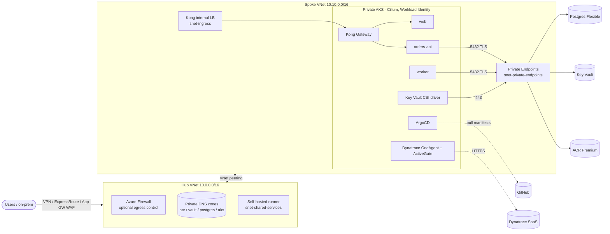

# Orders Platform — AKS reference implementation

A small microservices app (Python FastAPI) deployed the way enterprise platform teams run production on Azure:
**private AKS in a hub-spoke network, Private Endpoints everywhere, Key Vault + Workload Identity (no secrets in Git or pipelines),
Kong API gateway, GitOps with ArgoCD, GitHub Actions with OIDC, DevSecOps gates, and Dynatrace observability.**

| Service | What it does | Exposed via Kong |
|---|---|---|
| `web` | UI: place orders, watch status change | `/` |
| `orders-api` | REST API, writes orders to Postgres | `/api/orders` |
| `worker` | Processes `PENDING` orders (`FOR UPDATE SKIP LOCKED`, safe with N replicas) | — (internal only) |

## Architecture



Full request / identity / deployment flows: **[docs/architecture.md](docs/architecture.md)** · Troubleshooting: **[docs/runbook.md](docs/runbook.md)**

## Repository layout

```
services/                  3 FastAPI services (Dockerfile, tests, JSON logs, /healthz /readyz /metrics)
deploy/charts/microservice One hardened Helm chart for all services
deploy/envs/dev            Per-environment values (image tags bumped by CI = GitOps)
deploy/argocd              App-of-apps: projects, Kong, Dynatrace, namespaces, ApplicationSet for services
deploy/platform            Kong global plugins, DynaKube, namespace guardrails (PSA, quota, default-deny)
infra/terraform            Modules (hub, spoke, aks, acr, key-vault, postgres, private-endpoint, workload-identity) + envs/dev
.github/workflows          ci, security, terraform, release
scripts/                   bootstrap-azure.sh, bootstrap-cluster.sh, sync-tf-outputs.sh
docker-compose.yml         Full local stack incl. Kong (same routing as AKS)
```

## 1. Run locally (5 minutes)

```bash
make up        # postgres + 3 services + Kong (DB-less)
open http://localhost:8000
make test      # unit tests
make down
```

## 2. Deploy to Azure (first time)

| Step | Command / action | Who |
|---|---|---|
| 1 | `GITHUB_REPO=premgowda7/pyhtondemo ./scripts/bootstrap-azure.sh` – state storage, Entra app + OIDC federated credentials, RBAC | Subscription Owner, once |
| 2 | Set repo **variables** `AZURE_CLIENT_ID`, `AZURE_TENANT_ID`, `AZURE_SUBSCRIPTION_ID` (printed by step 1). Create environments `dev` (required reviewers) and `dev-release` | Repo admin |
| 3 | `az feature register --namespace Microsoft.Compute --name EncryptionAtHost` (or set `host_encryption_enabled = false`) | Once per subscription |
| 4 | Edit `infra/terraform/envs/dev/terraform.tfvars` (AKS admin group object ID), open a PR → review plan comment → merge → approve `dev` | You |
| 5 | `./scripts/sync-tf-outputs.sh` → commit `deploy/envs/dev/global.yaml`; set `ACR_NAME`, `ACR_LOGIN_SERVER` variables; grant `AcrPush` (command printed by step 1) | You |
| 6 | Put `dynatrace-api-token` and `dynatrace-data-ingest-token` in Key Vault; set your environment ID in `deploy/platform/dynatrace/dynakube.yaml` | You |
| 7 | From inside the network (cluster is private): `./scripts/bootstrap-cluster.sh` – installs ArgoCD, hands over to GitOps | Once |
| 8 | Push a change under `services/` → `release` builds, scans, pushes, bumps tags → ArgoCD deploys | Every release |

> **Private networking reality check.** With ACR / Key Vault / AKS API private, GitHub-hosted runners cannot reach them.
> Use a **self-hosted runner in `snet-shared-services`** and set repo variable `PRIVATE_RUNNER_LABEL`.
> For a first experiment only, `management_ip_ranges` in tfvars opens ACR / Key Vault to specific public IPs.
> Until step 2 is done, the Azure jobs in `terraform` and `release` are **skipped**, not failed.

## CI/CD & DevSecOps

| Workflow | Trigger | Gates |
|---|---|---|
| `ci` | PR, main | ruff (incl. bandit rules), pytest, Docker build, **Trivy** (fail on fixable HIGH/CRITICAL), Helm lint + kubeconform |
| `security` | PR, main, weekly | **gitleaks** (full history), **CodeQL** (Python + Actions), **Checkov** (Terraform, K8s, Actions, Dockerfiles), dependency review |
| `terraform` | PR / main on `infra/**` | fmt, validate, plan → PR comment; apply **the reviewed plan file** after `dev` environment approval |
| `release` | main on `services/**` | OIDC login → build → push with SBOM + provenance → Trivy on pushed image → commit new tags (ArgoCD deploys) |

No long-lived credentials exist anywhere: GitHub → Azure uses OIDC federation, pods → Key Vault use Workload Identity,
AKS → ACR uses the kubelet managed identity, Terraform state uses Entra ID (storage shared keys disabled).

## Security controls (summary)

- **Network:** private AKS API, Private Endpoints for ACR / Key Vault / Postgres, public access disabled, NSGs per subnet, Kong on an *internal* LB, optional Azure Firewall egress with FQDN allow-list, Cilium NetworkPolicies + namespace default-deny.
- **Identity:** Entra ID-only AKS (local accounts disabled, Azure RBAC), one managed identity per workload, Key Vault access scoped to **a single secret**.
- **Workload:** Pod Security Admission `restricted`, non-root UID 10001, read-only root FS, all capabilities dropped, seccomp `RuntimeDefault`, resource limits, PDBs, zero-downtime rollouts.
- **Supply chain:** pinned versions, Dependabot, SBOM + provenance attestations, image scanning before and after push, CODEOWNERS.
- **Data:** Postgres TLS enforced, secret files re-read on each new DB connection (Key Vault rotation needs no restart), `prevent_destroy` on the database.

## Known limitations / next steps

These are deliberate scope cuts. Each is a good next task:

1. **App uses the Postgres admin login.** Next: Entra ID auth for Postgres with the existing workload identities (passwordless), or a least-privileged DB role created by a migration Job.
2. **Schema via `create_all()`** at startup → move to Alembic migrations run as an ArgoCD PreSync Job.
3. **No self-hosted runner module** yet (Container Apps jobs or VMSS in `snet-shared-services`).
4. **No App Gateway / WAF** in front of Kong yet; TLS terminates at the edge you choose (cert-manager + Key Vault certs on Kong is the usual pattern).
5. **AKS control-plane audit logs** are not shipped (Checkov `CKV_AZURE_4` is skipped). Add a diagnostic setting to Log Analytics / Event Hub for `kube-audit-admin` if your security team requires it.
6. Image signing (Notation / cosign) + admission policy (Ratify / Azure Policy) to enforce it.
7. Only a `dev` environment; `prod` = new `envs/prod` folder + GitHub environment + values folder.

## Versions (validated)

Terraform ≥ 1.9 · azurerm **5.12** · Kong ingress chart **0.24.0** · Dynatrace Operator **1.11.1** (DynaKube `v1beta6`) · Argo CD chart **10.12.0** · Python 3.12 · Postgres 16
